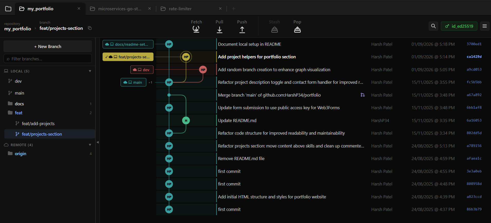
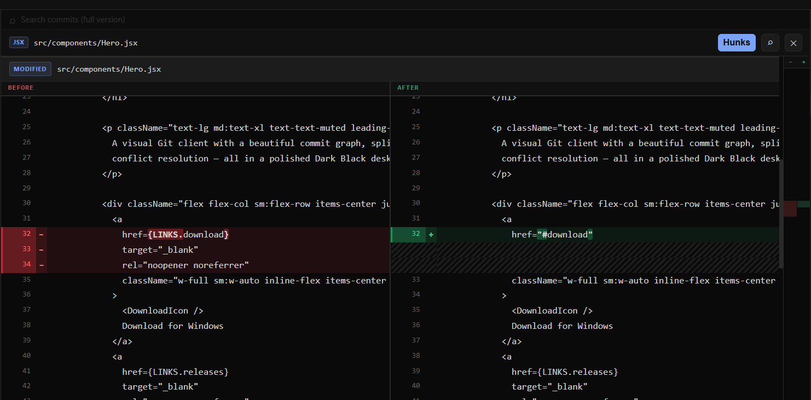
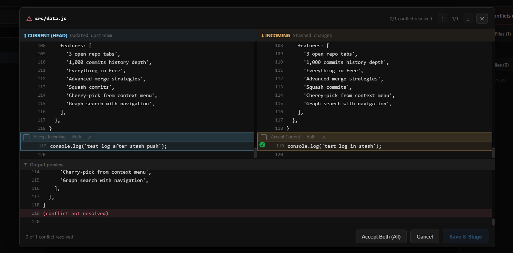

# Git Graph UI

  

**Website:** [gitgraphui.com](https://www.gitgraphui.com)

Git Graph UI is a free Git client for Windows. It puts your commit history in a visual graph, with split diffs, conflict resolution, and everyday Git work — all running locally on your machine.

## Screenshots

### Commit graph

### File diffs

### Merge conflicts

## Download

Get the latest Windows installer from our [GitHub releases page](https://github.com/HarshP34/gitgraphui-releases).

**Requirements:** Windows 10 or later (64-bit). Git for Windows recommended for SSH remotes.

If Windows SmartScreen shows “unknown publisher”, click **More info**, then **Run anyway**. The app is not code-signed yet, but it only runs on your PC — your repos never leave your computer.

## What's included

Everything is free — no account, no subscription.

| | |
|---|---|
| Repo tabs | 1 |
| Commit history | Up to 1,000 commits |
| Core Git | Checkout, branch, merge, revert, stash, push/pull |
| Graph | Visual commit graph, search, squash, cherry-pick |
| Merge strategies | Merge, rebase, no-ff, fast-forward |
| Diff & conflicts | Side-by-side diff viewer, conflict resolver |
| Privacy | Local-first — your code stays on your machine |

## Updates

Installed apps check [GitHub Releases](https://github.com/HarshP34/gitgraphui-releases) for new versions and can update automatically.

## Support

Questions, bug reports, or feedback — use the contact form on [gitgraphui.com](https://www.gitgraphui.com/#contact).

## Links

- **Website:** [gitgraphui.com](https://www.gitgraphui.com)
- **Downloads & releases:** [github.com/HarshP34/gitgraphui-releases](https://github.com/HarshP34/gitgraphui-releases)
